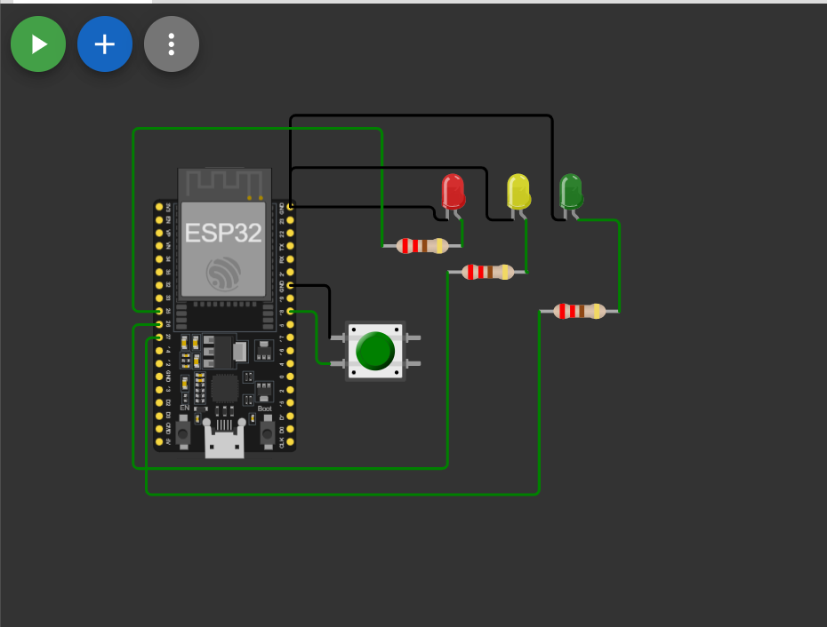
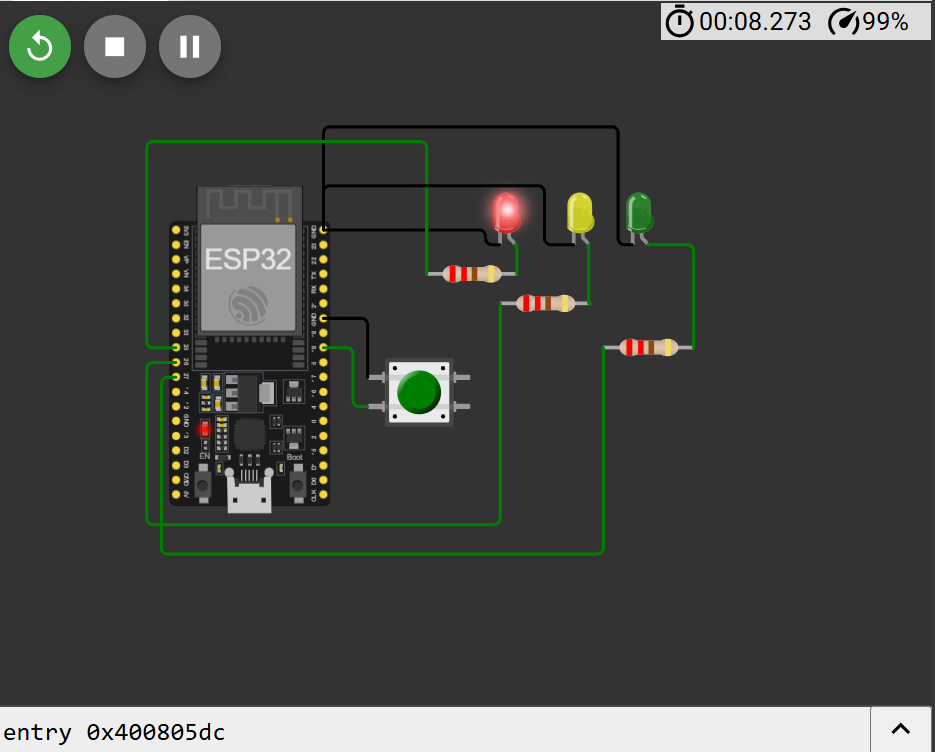

# ESP32 Traffic Light Controller

## Overview

This project implements an ESP32-based traffic light controller using three LEDs and a push button.

The controller operates a repeating Red → Yellow → Green sequence using non-blocking timing with `millis()`. An emergency button allows the normal sequence to be interrupted, activating the Red LED.

The project was developed and tested entirely in the Wokwi simulator.

## Features

- Three-LED traffic light sequence
- Non-blocking timing using `millis()`
- State-machine-based control
- Push-button input using `INPUT_PULLUP`
- Software button debouncing (50 ms)
- Emergency override to activate Red
- Emergency activation and deactivation using a single button
- Automatic restart of the normal sequence from Red after emergency deactivation

## Hardware Components (Simulated)

| Component | Quantity |
|---|---:|
| ESP32 DevKit V1 | 1 |
| Red LED | 1 |
| Yellow LED | 1 |
| Green LED | 1 |
| 220 Ω resistor | 3 |
| Push button | 1 |

## GPIO Configuration

| Component | ESP32 GPIO |
|---|---:|
| Red LED | GPIO25 |
| Yellow LED | GPIO26 |
| Green LED | GPIO27 |
| Emergency button | GPIO18 |

The button uses the ESP32 internal pull-up resistor. It reads HIGH when released and LOW when pressed.

## Traffic Light Timing

| State | Duration |
|---|---:|
| Red | 5000 ms |
| Yellow | 2000 ms |
| Green | 5000 ms |

These timings are for simulation and learning purposes only.

## Emergency Override

The push button toggles emergency mode:

1. First press activates emergency mode.
2. Red LED turns ON.
3. Yellow and Green LEDs turn OFF.
4. The normal traffic sequence remains paused.
5. A second press deactivates emergency mode.
6. The normal sequence restarts from Red.

A 50 ms software debounce interval is used to prevent one physical button press from being interpreted as multiple presses.

## Software Architecture

The program uses three main execution responsibilities:

- `loop()` — handles button input, debounce logic and emergency priority.
- `updateState()` — manages traffic-light state transitions.
- `updateLights()` — controls LED outputs according to the current state.

The `millis()` function is used instead of blocking `delay()` calls, allowing the ESP32 to continue checking button input while the traffic sequence operates.

## Circuit Diagram

## Emergency Mode Simulation

The following screenshot shows the Red LED activated during emergency mode.

## Project Files

- `sketch.ino` — ESP32 program.
- `diagram.json` — Wokwi circuit configuration.
- `images/circuit.png` — circuit screenshot.
- `images/emergency_mode.png` — emergency-mode screenshot.

## Tools Used

- Wokwi — circuit and ESP32 simulation
- Arduino framework
- Embedded C++

## Limitations

- This project was tested in simulation only.
- It is an educational prototype, not a safety-certified traffic controller.
- It does not implement real pedestrian signals, vehicle sensors or safety interlocks.

## Future Improvements

- Separate button-handling function.
- More robust emergency input handling.
- Improved output updates.
- Additional pedestrian request functionality.
- Hardware implementation and testing when physical components become available.